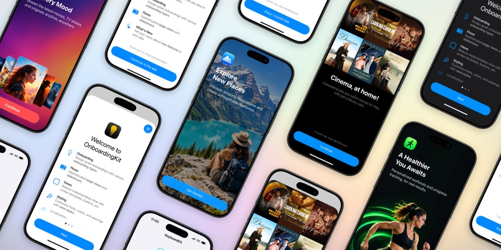
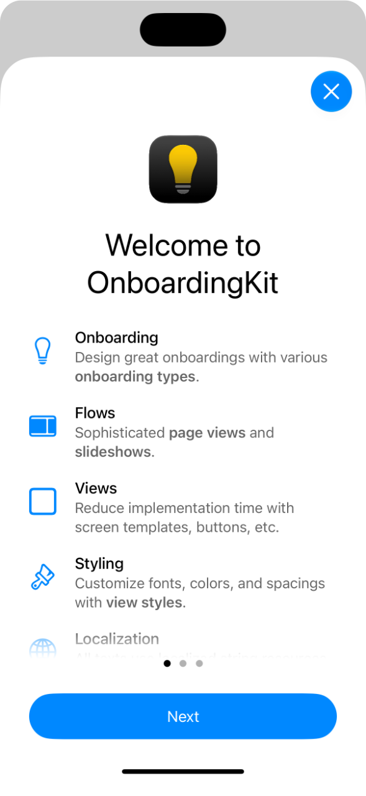
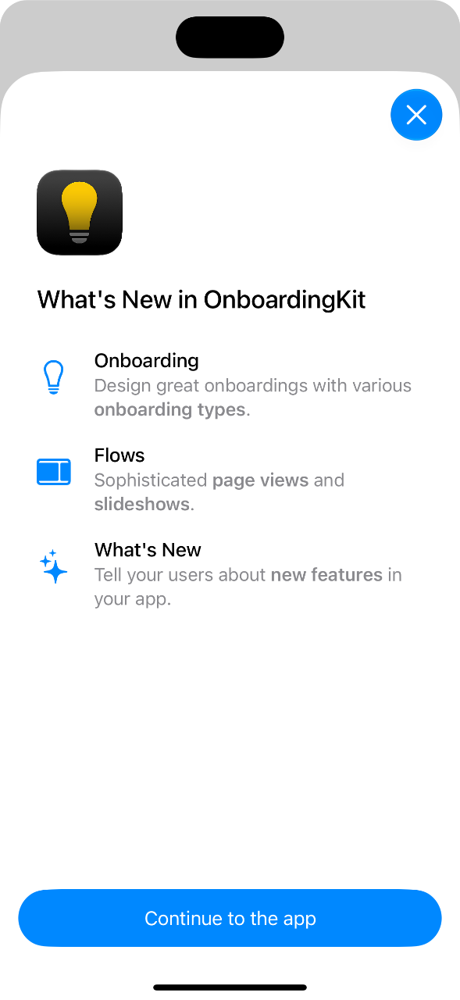
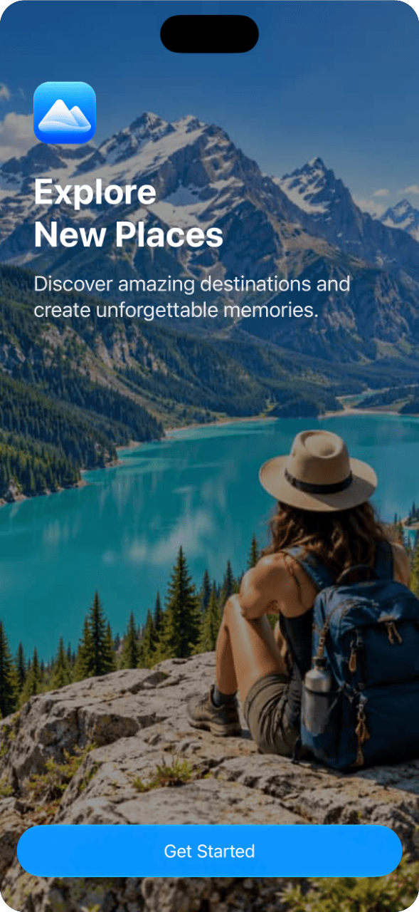

<p align="center">
    
</p>

<p align="center">
    
    
    <a href="https://kankoda.github.io/OnboardingKit"></a>
    <a href="https://kankoda.com/onboardingkit"></a>
</p>


# OnboardingKit

OnboardingKit is a Swift & SwiftUI SDK that lets you create flexible onboarding experiences on all Apple platforms. 

OnboardingKit has core models & views for modeling a perfect onboarding experience, as well as flows & screens for effortless presentations.




## Installation

OnboardingKit can be installed with the Swift Package Manager:

```
https://github.com/Kankoda/OnboardingKit.git
```

This package requires a license to be used. You can sign up for a free or paid license from the [website][Website], then register it as described in the [getting-started guide][Getting-Started].


## Getting Started

You must first use your license to unlock the SDK:

```swift
try await OnboardingKitLicense.register(.gumroad(licenseKey: "your-license-key"))
```

You can also use the `.onboardingKitLicense(...)` modifier on your app's root view, to automatically register your license on app launch:

```swift
@main
struct MyApp: App {

    var body: some Scene {
        WindowGroup {
            ContentView()
                .onboardingKitLicense(.gumroad(licenseKey: "...")) { result in
                    // Optional result handler
                }
        }
    }
}
```

You can now start creating and presenting onboarding experiences in your app. See the [getting-started guide][Getting-Started] for more information and [this blog post][Post] for inspiration.


### Onboarding types

An `Onboarding` determines *when* an onboarding experience should be presented. You can use it to present a sheet, a modal, a popover, a flow, or anything you want. There are several types:

* `regular` is presented right away, and only once.
* `conditional` is presented when a condition returns `true`.
* `delayed` is presented after a certain number of attempts.
* `correctBehavior` is used to establish a desired behavior, by presenting until the user gets it right.
* `sequence` presents the first onboarding in a list that should be presented.
* `whatsNew` is only presented if there are new items to tell the user about.

To use one, just call `tryPresent`:

```swift
Onboarding.regular(id: "welcome").tryPresent { _ in
    // Show a sheet, modal, popover, or anything you want.
}
```

OnboardingKit keeps track of what the user has seen, so you don't have to.


### Flows & Screens

OnboardingKit has two onboarding flow containers - `OnboardingPageFlow` and a `OnboardingSlideshow` - that can be used to present a collection of pages.

OnboardingKit also has various screen templates, like a `OnboardingWelcomeScreen`, `OnboardingWhatsNewScreen`, `OnboardingPromoScreen`, and `OnboardingCoverScreen`.

   

These screens can be styled and customized to great extent, and you can use them and their content as standalone views as well.


## Documentation

The [online documentation][Documentation] has a thorough getting-started guide, detailed feature articles, code samples, etc.


## Contact

This package is developed by [Kankoda][Kankoda] in Stockholm, Sweden. Feel free to [reach out][email] if you have any questions or feedback, or if you need support integrating this package into your app.


## Commercial License

This package requires a license to be used. You can sign up on the [product website][Website] or the [online license store][LicenseStore].


[Email]: mailto:info@kankoda.com
[Kankoda]: https://kankoda.com
[Website]: https://kankoda.com/onboardingkit

[Documentation]: https://kankoda.github.io/OnboardingKit/
[Getting-Started]: https://kankoda.github.io/OnboardingKit/documentation/onboardingkit/getting-started-article
[License]: https://github.com/Kankoda/OnboardingKit/blob/master/LICENSE
[LicenseStore]: https://kankoda.gumroad.com/onboardingkit

[Post]: https://danielsaidi.com/blog/2026/10/30/introducing-a-brand-new-onboardingkit
